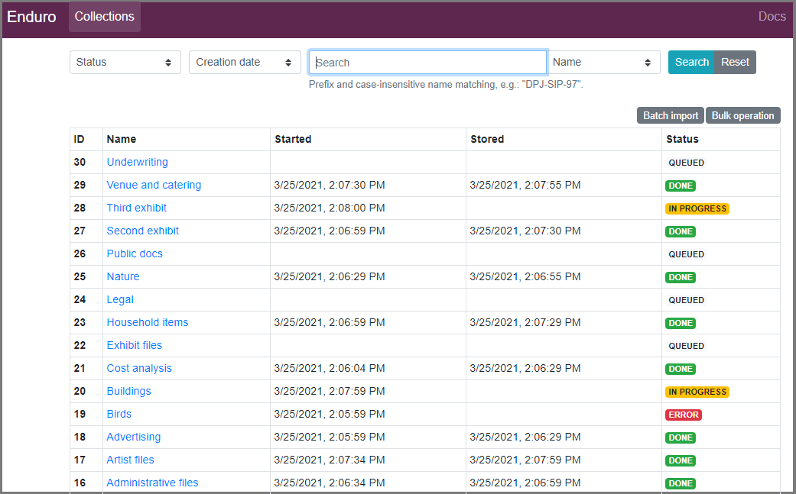
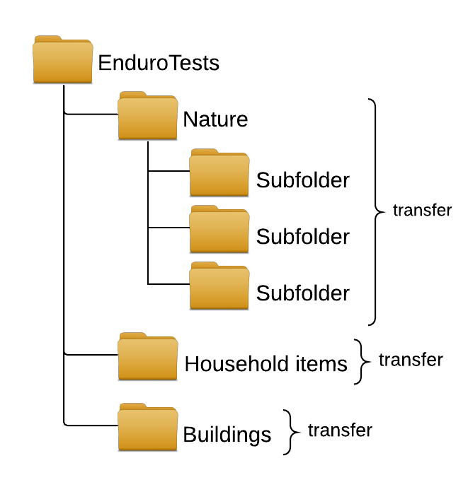
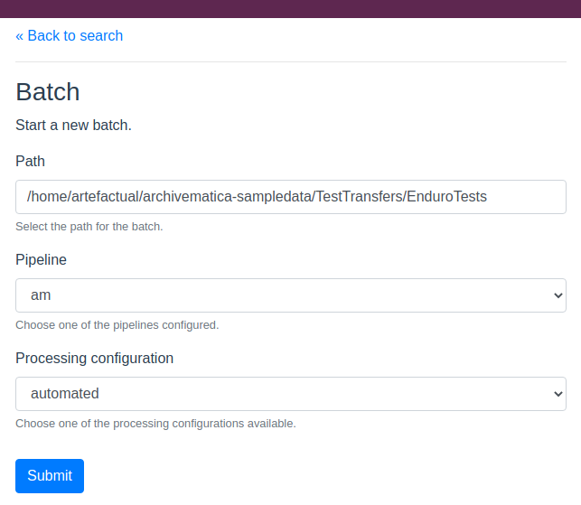
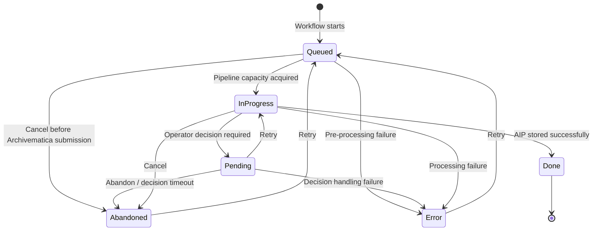

# User Manual

## Getting started

### The Enduro dashboard

This is the Enduro Collections dashboard, the default landing page for the
application. The dashboard lists individual transfers that were part of batch
ingests and shows their processing status.

- `QUEUED`: The transfer has been included in a batch import and is awaiting
  ingest into Archivematica.
- `IN PROGRESS`: The transfer has been ingested into Archivematica and is being
  processed.
- `DONE`: The transfer has been processed in Archivematica and the resulting
  AIP has been placed in archival storage.
- `ERROR`: The transfer was ingested into Archivematica but an error prevented
  it from being packaged into an AIP and/or placed in archival storage.

### Connection monitor

The widget in the lower-right corner shows the connection to
`/collection/monitor`, which delivers live collection updates. It helps spot
connection problems even when ingests and ordinary API requests still work.
Without this stream, collection information may stay stale until refreshed.

- **Connected**: the event stream is open.
- **Connecting**: opening or retrying the connection.
- **Failed**: at least four consecutive failures after a successful connection;
  automatic retries continue.

Click the widget for event counts, last-event time, and **Reconnect now**.
Heartbeats should arrive about every ten seconds. A stalled first connection
can remain **Connecting** indefinitely without reporting a failure. The widget
reports this connection's status, not Enduro's overall health.

There is currently no setting to hide the widget. See [Live updates behind
proxies] for setup and troubleshooting.

### Watching filesystem and object stores

It is possible to configure watchers that monitor filesystems or object stores
in order to start the processing of transfers automatically. See the [watcher
configuration section](./configuration-reference.md#watcher) for more details.

### Preparing transfers for batch import

- Enduro is designed to import and queue up multiple transfers for ingest into
  Archivematica. In order to prepare your holdings for import, you will need to
  place your transfers in a location that your administrator has set up for this
  purpose.
- Once your transfers are in place, you will be telling Enduro where to look for
  them to start the import process. You will be directing Enduro to look in a
  given parent directory, and it will import the entries at the selected depth
  in that parent directory.
- For example, if you create a top-level directory called *EnduroTests*, and
  place subdirectories called *Nature*, *Household items* and *Buildings*
  inside it, Enduro will consider each of those subdirectories to be transfers
  (regardless of the directory structure within those subdirectories).
- A transfer can be a directory or a non-hidden file such as a `.zip` file. For
  example, a batch directory can contain both `Nature/` and `Buildings.zip`.
  Enduro does not inspect zip contents while discovering the batch; the selected
  Archivematica transfer type controls how Archivematica processes the zip.
- The batch depth setting controls which level Enduro scans. Depth `0` means
  direct children of the batch path. Depth `1` means one level below that, and
  so on. Only entries at that depth are submitted as transfers.

### Starting a batch import

- To start a new batch ingest, click on Batch import in the upper right corner
  of the Collections tab. This will open a new batch import page.
- Enter the path of the directory containing the transfers to be ingested. When
  the batch path browser is configured, click Browse to select a directory under
  the configured browser root instead of typing the path manually.
- Select the Archivematica pipeline that will process the transfers. Optionally
  choose a **Processing configuration** from that pipeline.
- Set the depth when the transfers are not direct children of the selected batch
  path.
- Click **Submit**, review the path and processing configuration, then confirm
  the submission.

- Return to the Collections page. You will see a set of new transfers, likely
  with a status of QUEUED or IN PROGRESS.
- As each transfer is processed into an AIP and placed in archival storage, its
  status will change to DONE. Congratulations! You have just used Enduro to
  perform batch processing.
- NOTE: If you have your Archivematica dashboard open you will see the transfers
  appearing in the Archivematica transfer tab and then in the ingest tab. Once
  the transfers have finished processing and the AIP has been placed in archival
  storage, however, the transfers will no longer be visible in the transfer and
  ingest tabs. Enduro has cleared them out of those tabs in order to ensure that
  the tabs don't get cluttered. If a transfer fails in Archivematica, it can
  remain visible there in the Transfer or Ingest tab. Failures before
  submission, such as a bag check failure, appear in Enduro.

### Processing BagIt transfers

[Archivematica can ingest bags directly]. Enduro checks bag directories
submitted through batch imports or filesystem watchers, and bags extracted from
watched archives. It checks that the files listed in the manifests are still
present after filtering.

When delivering an unpacked bag to a filesystem watcher, prepare the whole
directory before renaming it into the watched folder on the same filesystem. If
you prepare it inside the watched folder, use a temporary name matched by the
watcher’s `ignore` setting. Leave `stripTopLevelDir` off when `bagit.txt` is at
the root of the directory you deliver.

Choose **Unzipped bag** for a source that should always send bags, or
**Standard** for a source that also sends ordinary folders. If your
Archivematica workflow expects the standard transfer layout, choose **Standard**
and enable `unbag` on the pipeline.

#### Choosing a transfer type

- **Watched folders** use the `transferType` in their
  [filesystem watcher settings]. Set it in the matching `[[watcher.filesystem]]`
  entry in `enduro.toml` for all transfers from that watcher.
- **Batch imports** use the **Transfer type** field on the **Batch import**
  form. Choose it for each batch. Leaving it blank uses **Standard**.

Use **Unzipped bag** when every transfer from the watcher or batch should be a
bag. Enduro reports a missing `bagit.txt` at the transfer root as a bag check
failure. Leave `unbag` off to send the bag intact and let Archivematica process
it as an unzipped bag. This lets Archivematica use the fields in
[`bag-info.txt` as source metadata].

Use **Standard** when the same watcher or batch also handles ordinary folders or
files. A `bagit.txt` at the transfer root tells Enduro to check the folder as a
bag before sending it as **Standard**. Ordinary folders skip the bag check.

#### Bag checks before submission

For batch imports, supply bags as unpacked directories to have Enduro check them
before submission.

Keep hidden-file filtering off when a bag's manifest lists hidden files. If a
batch source is already in the pipeline's transfer directory, filtering can
remove files from the source itself. When converting a bag, Enduro filters and
converts a private copy so the original is available for retry.

Enduro compares the files with the manifests after filtering hidden files and
before publishing the transfer or sending it to Archivematica. This checks which
files are present. Enduro verifies file contents against their checksums when it
unbags a transfer. If filtering removes a listed file such as `data/.DS_Store`,
Enduro marks the collection **ERROR** and frees its pipeline slot.

Each item in a batch has its own workflow. A failed bag check affects that
collection, and the other items in the batch continue processing.

Open the collection's **Workflow** tab for the reason and, when available,
counts of missing and unexpected files and up to ten example paths. If the
source bag was incomplete, correct it and retry the collection.

**Retry** uses the original transfer and filtering settings. If filtering
removed a required file, restore it at the source if needed and submit the
affected bag again with **Exclude hidden files** cleared for the batch, or
`excludeHiddenFiles = false` for the watcher.

#### Converting bags for Archivematica

Bag conversion is a pipeline setting. Set [`unbag`] to `true` in the
`[[pipeline]]` entry in `enduro.toml` for the pipeline that receives the watched
transfer or batch.

Enduro verifies the bag's checksums before converting it. Choose **Standard** to
send the converted directory to Archivematica.

### Viewing a transfer's processing configuration

Open a collection and look under **Pipeline** on the **Overview** tab. After
submission, **Processing configuration** shows the name Enduro sent to
Archivematica. Enduro uses the selection from the batch import form when
provided, or the [pipeline processing configuration] if set.

**Archivematica default** means Enduro left the choice to Archivematica. **Not
recorded** means the collection has no saved value, as with transfers submitted
before Enduro started recording this information.

If a retry reconciles an existing AIP, Enduro keeps the saved name. A full
reprocess records the configuration for the new transfer.

## Collection status state machine

Enduro collection statuses describe Enduro's view of the processing workflow.
The normal lifecycle is `queued` -> `in progress` -> `done`. Operator actions
and failures can move the collection into `pending`, `error`, or `abandoned`.
The actions below describe normal dashboard behavior; lower-level API endpoints
may accept a broader set of calls.

| Status | Meaning | Operator actions in the dashboard |
| --- | --- | --- |
| `queued` | Enduro has created the collection workflow, but the transfer has not started processing yet. It may be waiting for pipeline capacity. | Cancel is available when no Archivematica `transfer_id` has been assigned yet. Bulk Cancel also targets queued collections without a `transfer_id`. Delete is not shown while the collection is still running. |
| `in progress` | Enduro has acquired pipeline capacity and processing is underway. At this point the transfer may have been submitted to Archivematica. | Cancel is available. This stops Enduro's workflow, but it does not guarantee that already-submitted Archivematica work is stopped. Delete is not shown while the collection is still running. |
| `pending` | Processing needs an operator decision before it can continue, usually after an activity failed and Enduro is waiting for retry or abandon. | Retry and Abandon are available from the pending decision controls. Bulk Retry and Bulk Abandon also target collections in this state. Delete is not shown while the collection is waiting for a decision. |
| `done` | Processing completed successfully and the AIP was stored. | Delete is available. |
| `error` | Processing failed and the workflow ended without a successful or operator-abandoned outcome. | Retry and Delete are available. Bulk Retry also targets collections in this state. |
| `abandoned` | Processing was stopped by an operator decision or cancellation. | Retry and Delete are available. Bulk Retry also targets collections in this state. |
| `new` | Reserved by the API but not used by the current processing workflow. | No normal dashboard action. |
| `unknown` | Used when Enduro cannot map a status value to one of the known states. | Delete is available because the dashboard does not treat this as a running state. |

The main transitions are:

| From | To | Cause |
| --- | --- | --- |
| `queued` | `in progress` | Enduro acquires a pipeline capacity slot and starts the processing session. |
| `queued` | `abandoned` | An operator cancels the collection before an Archivematica transfer ID is assigned. |
| `queued` | `error` | The workflow fails before pipeline capacity is acquired, for example while checking duplicates, parsing metadata, loading configuration, or creating the processing session. |
| `in progress` | `pending` | A workflow activity requires an operator decision before continuing. |
| `pending` | `in progress` | An operator chooses Retry. |
| `pending` | `abandoned` | An operator chooses Abandon, or the pending decision times out. |
| `pending` | `error` | The decision path fails or receives an invalid decision value. |
| `in progress` | `done` | Processing, ingest, and storage complete successfully. |
| `in progress` | `error` | Processing fails without a successful or abandoned outcome. |
| `in progress` | `abandoned` | An operator cancels the Enduro workflow. |
| `error` | `queued` | An operator retries the collection, starting a new workflow run. |
| `abandoned` | `queued` | An operator retries the collection, starting a new workflow run. |

Cancel and Delete are different operations. Cancel asks Enduro to stop the
processing workflow when possible. For queued collections that do not have an
Archivematica transfer ID yet, canceling prevents submission to Archivematica.
Delete removes the Enduro collection record and does not cancel processing that
has already been started elsewhere.

### Choosing Retry, Abandon, Cancel, or Delete

Use Retry when Enduro should attempt to process the same collection again.
Retry is available for failed collections and abandoned collections. Bulk Retry
can target both `error` and `abandoned` collections.

Use Abandon only when a collection is `pending` and Enduro is waiting for an
operator decision. Abandon records that the pending workflow should stop instead
of retrying the failed activity. It is not the normal action for a workflow that
has already ended in `error`.

Use Delete when the Enduro record should no longer be tracked, for example test
imports, accidental submissions, duplicate entries, or packages that will be
rebagged and submitted again in a new batch. Delete removes the Enduro
collection row only. It does not cancel already-started processing, delete AIPs,
or remove Archivematica transfer or ingest records.

When duplicate rejection is enabled, Enduro ignores existing collections that
are already in `error` or `abandoned` while checking for duplicate names. If a
new rebagged package is still rejected as a duplicate, look for another existing
collection with the same name that is not in `error` or `abandoned`.

## Collection timeline fields

Collection timestamps describe different parts of the Enduro, Archivematica, and
Storage Service workflow. Some values are recorded by Enduro, while others can
come from Storage Service when recovery is enabled.

The API returns timestamps as UTC date-time strings. The dashboard displays those
same instants in the web browser's local time zone.

| Concept | API field | Dashboard location | Meaning |
| --- | --- | --- | --- |
| Collection created | `created_at` | Collection detail `Overview` tab, shown as `Created` | When Enduro created the collection record. A collection may remain `queued` after this time while it waits for pipeline capacity. |
| Processing first started | `started_at` | Collections page, shown as `Started`; collection detail `Overview` tab, shown as `Started` | The first time Enduro acquired pipeline capacity and began processing the collection. Retries do not replace an already recorded value. |
| Storage complete | `completed_at` | Collections page, shown as `Stored`; collection detail `Overview` tab, shown as `Stored` | The time Enduro treats the collection as stored. For a normal ingest this is the ingest/storage completion time. With storage reconciliation, this can come from Storage Service rather than the local workflow clock. |
| Primary AIP stored | `aip_stored_at` | Collection detail `Storage` tab, shown as `Primary AIP stored at` | The time Storage Service reports for the primary AIP package. This is available only when Enduro has recorded storage reconciliation data. |
| Storage last checked | `reconciliation_checked_at` | Collection detail `Storage` tab, shown as `Last checked at` | When Enduro last checked Storage Service for this collection. |

In normal operation, `Started` is recorded once and remains the first processing
start time for the collection. `Stored` records storage completion, not the time
of the most recent retry.

## Pipeline capacity

Pipeline capacity is the main operator-facing control for concurrent ingest
work. Each configured pipeline has its own `capacity`, and each active
workflow that is currently using that pipeline consumes one unit until Enduro
releases it.

In practice, throughput is shaped by more than one setting:

- `pipeline.capacity` limits concurrent work per Archivematica pipeline
- `worker.maxConcurrentSessionExecutionSize` limits concurrent workflow
  sessions across the whole Enduro worker
- `worker.maxConcurrentWorkflowsExecutionsSize` limits how many workflows the
  worker accepts from Temporal overall

Effective throughput is therefore the lowest limit that applies at that moment.
If worker-level limits are lower than the sum of all pipeline capacities, those
worker settings become the actual bottleneck. If a single pipeline has a low
capacity, that pipeline will queue new work even when other pipelines are idle.

Recovery also matters here. In the current implementation, post-ingest
reconciliation retries still occupy a pipeline slot until Storage Service
confirms the outcome or the retry window expires. On busy systems, that can
temporarily reduce effective throughput for recovery-enabled pipelines. See the
[Recovery Guide](./user-manual-recovery.md) for the current limitations and
operator impact.

When queue growth or unexpectedly low throughput shows up in production, check:

- whether `pipeline.capacity` reflects the actual safe ingest concurrency for
  each Archivematica pipeline
- whether worker-level concurrency caps are lower than the intended total
  pipeline throughput
- whether recovery-enabled pipelines are spending time waiting on
  post-ingest reconciliation

## Configuration

Enduro is configured via the `enduro.toml` configuration file, which uses
TOML.

The default search paths are `/etc/enduro.toml`, `$HOME/.config/enduro.toml`,
and the current directory. Additionally, users can indicate the configuration
file using the optional argument `--config=example.toml`.

The full configuration schema now lives in the
[Configuration Reference](./configuration-reference.md). Use that page for the
complete list of attributes, examples, and section-by-section reference
material.

Common entry points:

- [API server configuration](./configuration-reference.md#api)
- [Watcher configuration](./configuration-reference.md#watcher)
- [Pipeline configuration](./configuration-reference.md#pipeline)
- [Worker configuration](./configuration-reference.md#worker)
- [Workflow configuration](./configuration-reference.md#workflow)
- [Recovery Guide](./user-manual-recovery.md)
- [Example `enduro.toml`](https://github.com/artefactual-labs/enduro/blob/main/enduro.toml)

[archivematica can ingest bags directly]: https://www.archivematica.org/en/docs/archivematica-1.18/user-manual/transfer/bags/
[`bag-info.txt` as source metadata]: https://www.archivematica.org/en/docs/archivematica-1.18/user-manual/transfer/bags/#index-and-search-bag-metadata
[filesystem watcher settings]: ./configuration-reference.md#watcherfilesystem
[Live updates behind proxies]: ./installation.md#live-updates-behind-proxies
[pipeline processing configuration]: ./configuration-reference.md#processingconfig
[`unbag`]: ./configuration-reference.md#unbag-boolean
